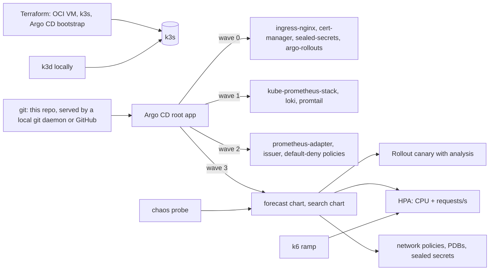

# k8s platform with GitOps

Two services from this portfolio, the demand-forecast API (P6) and the hybrid search service (P8), run the
way a platform team runs things: Terraform for the infrastructure, k3s for the cluster, Helm charts for the
workloads, Argo CD for GitOps with an app-of-apps and sync waves, ingress-nginx and cert-manager, Argo
Rollouts canaries gated by Prometheus analysis, horizontal autoscaling on CPU and request rate, default-deny
network policies, Sealed Secrets, kube-prometheus-stack and Loki, policy checks in CI, and a chaos test with
a written postmortem. Everything runs on a k3d cluster on the laptop with one script, and on an Oracle
Cloud always-free VM with Terraform.

**Status: built and verified on the local cluster (2026-10-17); the cloud environment is written and
validated, not applied.** The numbers below come from the committed scripts on this machine.

## Results

<!-- RESULTS -->
- **Autoscaling (k6 ramp 5 -> 60 requests/s of uncached hybrid searches through the ingress; HPA on CPU and on requests/s per pod from prometheus-adapter):** baseline 2 ready replicas; the HPA raised its target 95 s after the test started (load step at 60 s), the first new replica was ready **59 s after the load step**, peak 6 ready replicas. k6 saw 17,108 requests, 0.49% failed, p50 41 ms, p95 2601 ms, p99 3358 ms over the whole ramp, the tail being the minute before the new replicas were ready.
- **Chaos (an uncached BM25 search every 0.5 s through the ingress while the platform is attacked; outage = first failed to first successful probe):**

  | experiment | probes | failed | first failure after action | outage | recovered after action |
  |---|---|---|---|---|---|
  | delete-all-api-pods | 126 | 26 | 0.88 s | **23.14 s** | 24.02 s |
  | cordon-and-drain-node | 62 | 61 | 6.26 s | **n/a** | n/a |
  | uncordon-node | 131 | 38 | 0.63 s | **26.78 s** | 27.41 s |

  The timeline and what each number means for the design are in `docs/POSTMORTEM.md`.
<!-- /RESULTS -->

How they were measured: `make load` runs k6 through the ingress with a ramp from 5 to 60 requests/s while
the HPA is watched; the reaction time is the time from the load step to the first new replica reporting
ready, from the HPA and pod events. `make chaos` runs an uncached search every half second through the ingress while
every search API pod is deleted, then while the agent node is cordoned and drained, then while it is
uncordoned; the outage is the time between the first failed and the first successful probe. The postmortem is `docs/POSTMORTEM.md`.

## Architecture



| Piece | Where |
|---|---|
| Cluster | `scripts/bootstrap-local.sh` (k3d), `infra/terraform` (OCI VM with k3s by cloud-init) |
| GitOps | `platform/argocd` (values, root app), `envs/<env>/apps` (one Application per component, sync waves), `envs/<env>/values` |
| Workloads | `charts/search` (OpenSearch, Redis, API as a Rollout, UI, indexer job, HPA, PDB, policies, monitors, alerts, dashboard), `charts/forecast` (MLflow, API, train job, HPA, PDB, policies, monitors, alerts) |
| Platform extras | `charts/platform-extras` (ClusterIssuer, namespaces with pod-security labels, default-deny and baseline allows) |
| Guard rails | `platform/policies/*.rego` (conftest), `kubeconform`, `helm lint`, all in CI for both environments |
| Experiments | `load/hpa-load.js` (k6), `chaos/run.sh` (probe + pod delete + node drain) |

## Quick start (local)

Needs Docker Desktop, k3d, kubectl, helm; the P6 and P8 images built locally (`make images` in those
repos) and the P8 prepared data on disk (the bootstrap mounts it).

```bash
make bootstrap     # cluster, images, local git daemon, Argo CD, root app; then Argo installs the rest (10 to 15 min)
make status        # applications and any pod that is not running
make argocd-ui     # admin password and a port-forward
# edit a chart or a value, commit, then:
make push          # the local git daemon gets main; Argo CD syncs within a minute
make load          # autoscaling under load
make chaos         # pod deletion and node drain with the probe
make canary-bad    # a rollout the analysis must abort
```

Hosts: `https://search.localtest.me:8443`, `https://forecast.localtest.me:8443`, `https://grafana.localtest.me:8443` (certificates from the platform's own CA, so the browser warns once; plain HTTP on 8180 redirects).

## How it works

**GitOps (ADR 0002).** One root Application applied by hand points at `envs/local/apps`; every other
Application is in git with a sync wave; automated sync with prune and self-heal. Locally a git daemon in
Docker serves this repository to the cluster so nothing has to be pushed to GitHub to demonstrate the
loop; the cloud overlay points at GitHub.

**Rollouts and scaling (ADR 0003).** The search API is an Argo Rollout: 10% then 50% canary through the
ingress-nginx traffic router, each step gated by an AnalysisTemplate on the 5xx share and the p99 from
Prometheus. The HPA scales it on CPU and on `http_requests_per_second` per pod from prometheus-adapter.

**Security (ADR 0004).** Default-deny network policies per namespace with explicit allows per edge, pod
security baseline labels, non-root containers, Sealed Secrets for environments that live in git (a plain
dev-only secret for the throwaway local cluster, clearly marked), conftest policies in CI.

**Observability.** kube-prometheus-stack with the services' own ServiceMonitors, PrometheusRules and
Grafana dashboards shipped by the charts; Loki with Promtail; Alertmanager.

**Chaos (ADR 0005).** A probe measures the outage while pods are deleted and a node is drained; the
postmortem is written from those numbers and its actions change the charts.

## Deployment

`infra/terraform` creates an always-free ARM VM on Oracle Cloud and bootstraps k3s and Argo CD pointed at
`envs/oci`; `docs/DEPLOY.md` has the steps, the DNS and TLS notes, and how secrets are sealed. Not applied
without the owner's account.

## Limitations

- One node locally and in the cloud: the drain experiment shows pods rescheduling onto the server node,
  not a multi-node failover.
- Argo CD itself is installed by the bootstrap, not by Argo CD.
- Chart versions in Application manifests are bumped by hand.
- The forecast image is 3.7 GB and the search image 4.7 GB (training stacks inside); slimmer serving
  images are the first thing a platform team would ask the service owners for.

## What went wrong while bringing it up

Kept because the fixes are the kind of thing a platform engineer is hired for, and each is a commit.

- **Server-side apply drift.** Argo CD with `ServerSideApply=true` reported CRDs and StatefulSets as
  permanently OutOfSync: the API server drops `spec.preserveUnknownFields` from v1 CRDs and reports
  `volumeClaimTemplates` with `apiVersion`, `kind` and `status` that no chart writes. Fixed with
  `ignoreDifferences` for CRDs per Application and one global rule for StatefulSets in the Argo CD config.
- **Stuck sync operations.** A sync waits for the health of wave 0 before applying wave 1; when wave 0
  cannot become healthy (MLflow below, OpenSearch below) the operation waits forever and later commits are
  never applied. Terminating the operation lets automated sync pick up the fix. Argo CD's health is the
  gate, so a wrong resource limit becomes a stalled pipeline.
- **PostSync hooks that the sync depends on.** The index build and the model training were PostSync Jobs,
  but both APIs report not-ready until that output exists, so on a fresh cluster the sync waited for the
  APIs and the hooks waited for the sync. The Jobs are now ordinary resources in sync wave 1 with
  `Replace=true`; the APIs are wave 2. The Compose stacks hid this because their data already existed.
- **MLflow OOM-killed at 1.5 GB.** `mlflow server` starts four uvicorn workers by default, each loading the
  full stack, and even with `--workers 1` the 3.17 server sits at about 1.7 GB after start-up (its job
  executor and the artifact proxy). One worker and a 3 GB limit; the Compose stack never showed it because
  it had no limit.
- **Pod security vs. OpenSearch.** The usual privileged init container that sets `vm.max_map_count` is
  rejected by the `baseline` pod-security level. The sysctl is a node setting: cloud-init on the VM, and a
  check in the bootstrap script locally (Docker Desktop's VM already ships 1048576).
- **Helm charts from Docker Hub.** Argo CD needs the OCI registry registered as a repository (type helm,
  `enableOCI`), or its repo-server skips the anonymous token exchange and gets 401 on the manifest.
- **One machine, one memory budget.** This cluster, the search project's own Compose stack and a GPU
  training job together OOM-killed Docker Desktop's VM (15.5 GB). `docs/DEPLOY.md` says what to stop first.

## Decision records

`docs/decisions/`: 0001 k3s everywhere, no managed cluster; 0002 Argo CD app-of-apps with a local git
daemon; 0003 canary with Argo Rollouts and Prometheus analysis; 0004 default-deny policies, Sealed Secrets
and policy checks; 0005 chaos with a probe and a written postmortem. `docs/PLAN.md` is the plan.
