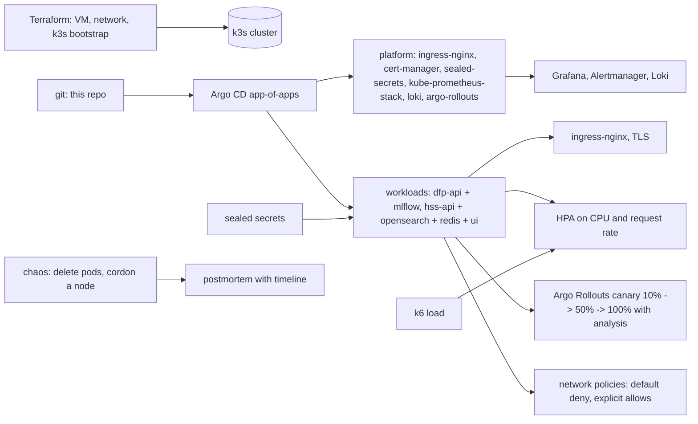

# Plan

Written before the code; updated where the build changed it.

## Goal

Run two of the portfolio's services (the P6 demand-forecast API and the P8 hybrid-search API with its
dependencies) the way a platform team would: Terraform for the infrastructure, Kubernetes with Helm charts,
Argo CD for GitOps, cert-manager and ingress-nginx, kube-prometheus-stack and Loki, horizontal autoscaling
shown under load, a canary rollout, network policies, secrets through Sealed Secrets, and a chaos test with
a written postmortem.

## Where it runs

- **Locally, end to end:** a k3d cluster (k3s in Docker) on this machine. Everything in the repo applies
  to it unchanged, which is how the autoscaling, canary and chaos numbers in the README are produced.
- **In the cloud, with Terraform:** an Oracle Cloud always-free ARM VM (the same account P1 and P8 use)
  bootstrapped with k3s by cloud-init; Terraform writes the kubeconfig out. The manifests are the same;
  only the Terraform and a values overlay differ. Not applied without the owner's account.

## Architecture

- **Charts:** one Helm chart per workload under `charts/`, values per environment under `envs/`; the
  images are the ones P6 and P8 build (pulled from GHCR; local k3d imports the local images).
- **GitOps:** Argo CD installed by Terraform (cloud) or a bootstrap script (local); an app-of-apps points
  at `envs/<env>/`; everything else is a sync.
- **Rollouts:** Argo Rollouts canary for the search API with an analysis template on error rate and p99
  from Prometheus; a bad image is rolled back by the analysis, and the README shows both a good and an
  aborted rollout.
- **Autoscaling:** HPA on CPU plus a custom metric (requests per second from Prometheus via the adapter);
  k6 ramps load, the README reports the time from the load step to the first new replica ready and the
  p99 before and after.
- **Security:** default-deny network policies per namespace with explicit allows; Sealed Secrets for the
  API keys and database passwords; non-root containers; resource requests and limits; PodDisruptionBudgets.
- **Observability:** kube-prometheus-stack with the services' own dashboards and alert rules imported,
  Loki with Promtail for logs, Alertmanager routes.
- **Chaos:** a script deletes the search API pods and then cordons and drains a node (local: the k3d
  agent); the recovery time is measured from the first failed request to the first successful one, and
  `docs/POSTMORTEM.md` is written in the incident format with a timeline.

## Numbers to produce

- Recovery time after pod deletion and after node drain (seconds of failed requests, as measured by a
  k6 probe running during the test).
- Autoscaling reaction time: seconds from load start to the new replica serving, and p99 before and after.

## Milestones

1. k3d cluster, platform apps via Argo CD, ingress and TLS, the two workloads with charts.
2. HPA with the Prometheus adapter and the k6 load; canary with Argo Rollouts and analysis.
3. Network policies, Sealed Secrets, PDBs; Loki and the dashboards.
4. Chaos test, postmortem, Terraform for the VM, CI (helm lint, kubeconform, conftest, terraform validate),
   documentation.
